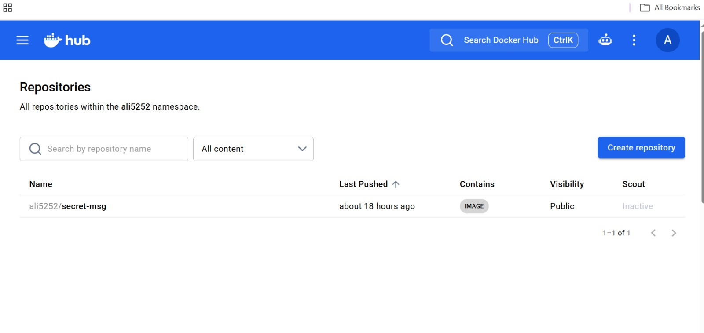
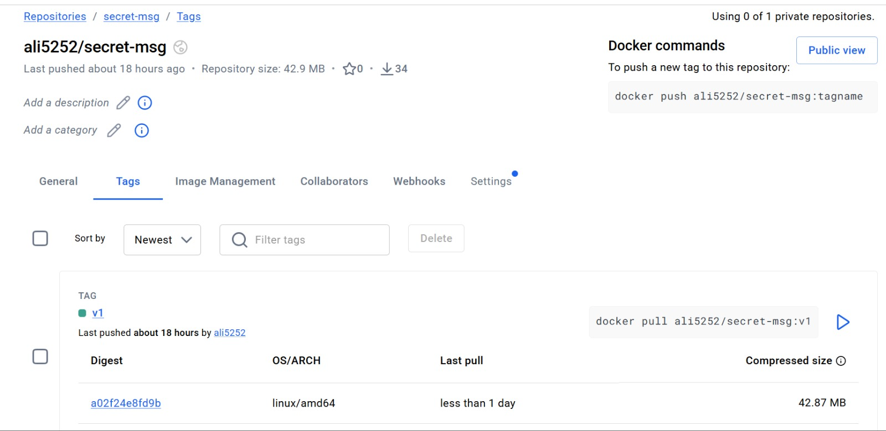

# Docker Lab 1: The Friend-to-Friend Image Exchange

**Author:** Ali Muhammad Younis
**Docker Hub:** [`ali5252/secret-msg`](https://hub.docker.com/r/ali5252/secret-msg)
**Environment:** Windows 10, Docker Desktop (Docker 29.8.2), Command Prompt

A small containerisation lab. I packaged a Python "Secret Message" app into a Docker image, published it to Docker Hub, pulled it back from the cloud, ran it with runtime configuration, debugged it with logs and `exec`, cleaned up, and finally ran it with Docker Compose.

---

## Table of Contents

1. [What the app does](#1-what-the-app-does)
2. [Project structure](#2-project-structure)
3. [Setup and verification](#3-setup-and-verification)
4. [Build the image](#4-build-the-image)
5. [Push to Docker Hub](#5-push-to-docker-hub)
6. [Verify the image from the cloud](#6-verify-the-image-from-the-cloud)
7. [Run with environment variables](#7-run-with-environment-variables)
8. [Debugging: logs and exec](#8-debugging-logs-and-exec)
9. [Image layers](#9-image-layers)
10. [Networking](#10-networking)
11. [Cleanup](#11-cleanup)
12. [Docker Compose](#12-docker-compose)
13. [Screenshots](#13-screenshots)
14. [Key concepts learned](#14-key-concepts-learned)
15. [Lab checklist](#15-lab-checklist)

---

## 1. What the app does

`app.py` reads an environment variable called `SECRET_MSG` and prints it. If the variable is not set, it prints a default message.

```python
import os
message = os.getenv('SECRET_MSG', 'No secret message found!')
print('=' * 30)
print(f'MESSAGE FROM A FRIEND: {message}')
print('=' * 30)
```

The message is read at **runtime**, not at build time. The same image can behave differently just by changing the environment variable, with no code changes.

## 2. Project structure

```
docker_exchange/
├── app.py
├── Dockerfile
└── docker-compose.yml
```

**Dockerfile**

```dockerfile
FROM python:3.9-slim
COPY app.py /app.py
CMD ["python", "/app.py"]
```

| Instruction | Purpose |
|---|---|
| `FROM python:3.9-slim` | Start from a minimal Debian image with Python 3.9 |
| `COPY app.py /app.py` | Copy the app into the image |
| `CMD ["python", "/app.py"]` | Default command when the container starts |

## 3. Setup and verification

```bash
docker --version
docker run hello-world
```

Result: `Docker version 29.8.2` and the "Hello from Docker!" message, so the Docker engine and Docker Hub access were working.

Then logged in to Docker Hub:

```bash
docker login
```

Result: `Login Succeeded`.

## 4. Build the image

```bash
docker build -t ali5252/secret-msg:v1 .
```

The image name follows the format `username/repository:tag`. The final `.` is the build context (the current folder).

Key line from the build output:

```
=> => naming to docker.io/ali5252/secret-msg:v1
```

## 5. Push to Docker Hub

```bash
docker push ali5252/secret-msg:v1
```

Result: every layer reported `Pushed`, ending with:

```
v1: digest: sha256:7de2af4c37537d4e202fd1e30100518207855d9742e6bf010882090c02929adf size: 856
```

## 6. Verify the image from the cloud

To prove the image on Docker Hub is complete, I deleted the local copy and pulled it again:

```bash
docker rmi ali5252/secret-msg:v1
docker pull ali5252/secret-msg:v1
```

The pulled digest was the same as the pushed one (`sha256:7de2af4c...`), which confirms the same image came back from the registry.

> **Note on two digests:** the push and pull output show `7de2af4c...`, which is the *manifest list* (an index that wraps the image and its build attestation). The Docker Hub Tags page shows `a02f24e8fd9b` for the `linux/amd64` image itself. Both refer to the same upload.

## 7. Run with environment variables

```bash
docker run --rm -e SECRET_MSG="Pizza is on me tonight!" ali5252/secret-msg:v1
```

Output:

```
==============================
MESSAGE FROM A FRIEND: Pizza is on me tonight!
==============================
```

Without `-e`, the default from the code is used:

```bash
docker run --rm ali5252/secret-msg:v1
```

```
==============================
MESSAGE FROM A FRIEND: No secret message found!
==============================
```

| Flag | Meaning |
|---|---|
| `--rm` | Remove the container automatically when it exits |
| `-e KEY=VALUE` | Set an environment variable at runtime |

## 8. Debugging: logs and exec

**Run in the background and inspect:**

```bash
docker run -d --name mytest ali5252/secret-msg:v1
docker ps -a
docker logs mytest
docker rm mytest
```

`docker ps -a` showed `Exited (0)`. Exit code `0` means the app finished without errors; it exits right after printing. `docker logs` returned the app's printed output.

**Look inside a running container.** The app exits immediately, so I kept a container alive with `sleep`:

```bash
docker run -d --name myapp ali5252/secret-msg:v1 sleep 300
docker exec myapp env
docker exec myapp cat /app.py
docker rm -f myapp
```

Findings:

- `env` showed `PYTHON_VERSION=3.9.25`, so Python lives inside the image and nothing had to be installed on the host.
- `SECRET_MSG` was **not** in the environment, because this container was started without `-e`. Configuration is supplied at runtime, not stored in the image.
- `cat /app.py` showed the app file exists inside the container, so `COPY` worked.

## 9. Image layers

```bash
docker history ali5252/secret-msg:v1
```

| Layer | Size |
|---|---|
| Debian base | 87.4 MB |
| Python installation | 45.7 MB |
| `COPY app.py /app.py` (my code) | 8.19 kB |

Almost the whole image is the base. My own code is a tiny top layer, which is why Dockerfiles copy frequently changing code **last**: Docker can reuse the cached layers below it.

Size note: `docker images` shows about 183 MB (uncompressed, local), while Docker Hub shows 42.87 MB (compressed).

## 10. Networking

```bash
docker network ls
docker network inspect bridge
```

Default networks: `bridge`, `host`, `none`. The default `bridge` network used subnet `172.17.0.0/16` with gateway `172.17.0.1`.

## 11. Cleanup

```bash
docker system df
docker container prune
docker ps -a
docker images
```

After pruning, `docker ps -a` was empty. `docker system df` showed 2 images and 0 containers.

> Avoid `docker system prune -a` on a working machine. It removes every unused image, including the ones you built.

## 12. Docker Compose

**docker-compose.yml**

```yaml
services:
  app:
    build: .
    environment:
      - SECRET_MSG=Hello from Compose!
```

```bash
docker compose up --build
docker compose down
docker rmi docker_exchange-app
```

Output:

```
 ✔ Image docker_exchange-app       Built
 ✔ Network docker_exchange_default Created
 ✔ Container docker_exchange-app-1 Created
app-1  | MESSAGE FROM A FRIEND: Hello from Compose!
app-1 exited with code 0
```

Compose built the image, created a network, and started the container from one YAML file instead of a long `docker run` command. `docker compose down` removed the container and network.

## 13. Screenshots

Screenshots from Docker Hub, stored in the `images/` folder:

| What it shows | File |
|---|---|
| Docker Hub repository list (public image) | `images/dockerhub-repositories.png` |
| Tags tab with `v1`, `linux/amd64`, 42.87 MB | `images/dockerhub-tags.png` |




## 14. Key concepts learned

| Concept | Meaning |
|---|---|
| **Image** | Read-only blueprint, built from a Dockerfile |
| **Container** | A running instance of an image, with its own writable layer |
| **Docker Hub** | Public registry for sharing images, like GitHub for images |
| **Dockerfile** | Step-by-step instructions to build an image |
| **Environment variable** | Configuration given at runtime with `-e`, never baked into the image |
| **Layers and caching** | Each instruction is a layer; unchanged layers are reused |
| **Exit code 0** | The container finished without errors |
| **Docker Compose** | Defines and runs containers from one YAML file |

**Discussion questions**

1. *Did I install Python to run the app?* No. Python 3.9 was packaged inside the image.
2. *Did the container change files on my laptop?* No. The container filesystem is isolated.
3. *How would a database password be passed?* With `-e DB_PASSWORD=...` at runtime, or from a secrets manager in production. Never inside the image.

## 15. Lab checklist

- [x] Docker installed and tested with `hello-world`
- [x] `app.py` and `Dockerfile` created
- [x] Image built and tagged `ali5252/secret-msg:v1`
- [x] Image pushed to Docker Hub (public)
- [x] Local image removed and pulled again from Docker Hub
- [x] Run with and without `-e`
- [x] `docker logs`, `docker ps -a`, `docker exec`, `docker history`
- [x] `docker network ls` and `docker network inspect bridge`
- [x] Cleanup with `docker container prune` and `docker system df`
- [x] Docker Compose (`up --build` and `down`)
- [ ] Friend exchange (pull and run a classmate's image): optional, needs a partner
- [ ] SSH into a partner's machine (Module 11): optional, needs a partner

## Run it yourself

```bash
docker pull ali5252/secret-msg:v1
docker run --rm -e SECRET_MSG="Hello from your machine!" ali5252/secret-msg:v1
```
